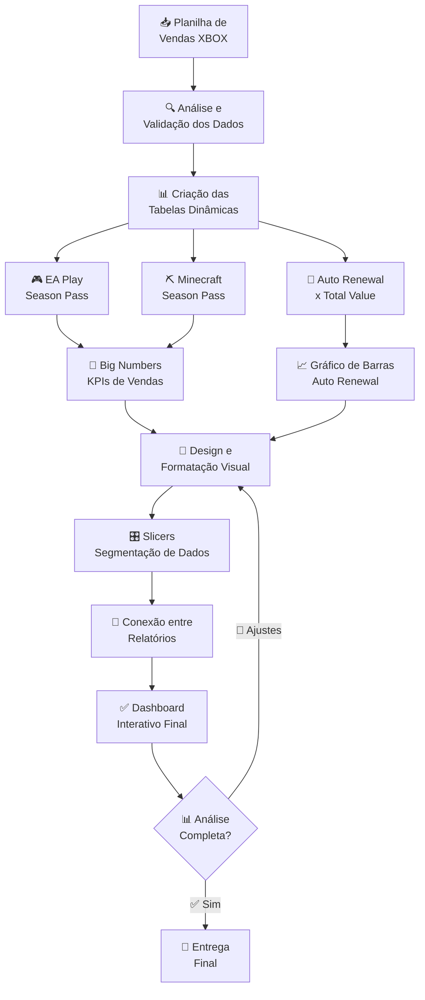

# 🎮 Dashboard de Vendas XBOX

<div align="center">


**Dashboard interativo de indicadores de vendas e assinaturas XBOX desenvolvido em Excel**

[📊 Tabelas Dinâmicas](#-criação-das-tabelas-dinâmicas) • [🔢 Indicadores](#-criação-dos-indicadores-big-numbers) • [📈 Gráficos](#-criação-dos-gráficos) • [🎛️ Interatividade](#-interatividade) • [🚀 Resultados](#-resultados-obtidos)

</div>

---

## 📌 Sobre o Projeto

Projeto de criação de um **dashboard interativo** baseado em uma planilha de vendas do **XBOX**, aplicando técnicas de análise de dados, tabelas dinâmicas e visualização de informações.

> A proposta foi replicar as técnicas apresentadas durante o curso, construindo uma visualização clara e profissional dos **indicadores de vendas e assinaturas**, com atualização dinâmica via segmentadores de dados.

---

## 🎯 Objetivo

Criar um **dashboard interativo e dinâmico** capaz de oferecer:

<div align="center">

| # | 🎯 Entregável | 📋 Descrição |
|---|---|---|
| 1 | 📊 **Tabelas Dinâmicas** | Cruzamento de dados de assinaturas e valores |
| 2 | 🔢 **Big Numbers** | Indicadores rápidos de vendas por produto |
| 3 | 📈 **Gráficos Dinâmicos** | Visualização comparativa de Auto Renewal × Total Value |
| 4 | 🎛️ **Slicers** | Segmentação interativa dos dados por filtros |
| 5 | 🎨 **Design Profissional** | Layout visual padronizado e intuitivo |

</div>

---

## 🛠️ Etapas de Desenvolvimento

### 📊 1. Análise dos Dados

```
📥 Planilha de Vendas XBOX
 │
 ├── 🔍 Exploração dos dados
 ├── ✅ Validação e consistência
 └── 📌 Identificação das métricas relevantes
      ├── 🎮 EA Play Season Pass
      ├── ⛏️ Minecraft Season Pass
      └── 🔄 Auto Renewal
```

---

### 📈 2. Criação das Tabelas Dinâmicas

Foram construídas **3 Tabelas Dinâmicas** para alimentar o dashboard:

| # | 🏷️ Tabela Dinâmica | 📊 Linhas | 💰 Valores |
|---|---|---|---|
| 1 | 🎮 **EA Play** | EA Play Season Pass | Soma de Subscription Price |
| 2 | ⛏️ **Minecraft** | Minecraft Season Pass | Soma de Subscription Price |
| 3 | 🔄 **Auto Renewal** | Auto Renewal | Soma de Total Value |

---

### 🔢 3. Criação dos Indicadores — Big Numbers

Os **Big Numbers** são cartões de destaque que exibem os KPIs mais importantes de forma imediata:

```
  ┌────────────────────────┐    ┌────────────────────────┐
  │    🎮 EA Play          │    │   ⛏️ Minecraft        │
  │    Season Pass         │    │   Season Pass          │
  │                        │    │                        │
  │   💰 $X.XXX.XXX        │    │   💰 $X.XXX.XXX       │
  │   Total Vendas         │    │   Total Vendas         │
  └────────────────────────┘    └────────────────────────┘
```

---

### 📉 4. Criação dos Gráficos

Foi criado um **gráfico de barras** comparativo para análise do impacto do Auto Renewal:

<div align="center">

| 📊 Gráfico | 📋 Eixo X | 💰 Eixo Y | 🎯 Finalidade |
|---|---|---|---|
| 📊 **Barras — Auto Renewal** | Sim / Não | Total Value | Comparar renovação automática vs. manual |

</div>

```
  Total Value
  ▲
  │  ████████████████████  ← 🔄 Auto Renewal: SIM
  │  ██████████           ← 🔄 Auto Renewal: NÃO
  │
  └──────────────────────► Auto Renewal
        NÃO      SIM
```

---

### 🎨 5. Design e Formatação

A identidade visual do dashboard seguiu a **paleta de cores oficial do XBOX** 🎮:

<div align="center">

| 🎨 Elemento | 🖌️ Tratamento Aplicado |
|---|---|
| 🎨 **Paleta de Cores** | Verde XBOX (#107C10) + tons complementares |
| 📐 **Linhas e Colunas** | Ajuste de largura e altura para layout clean |
| 🖼️ **Ícones** | Inserção de ícones representativos por categoria |
| 📝 **Caixas de Texto** | Títulos e rótulos formatados manualmente |
| 🎯 **Cores de Fundo** | Fundo padronizado e consistente entre planilhas |
| 📦 **Agrupamento** | Elementos visuais agrupados para facilitar movimentação |
| 🔒 **Objetos Fixos** | Configurados para não mover/redimensionar com células |
| ✨ **Conformidade Visual** | Padrão aplicado em todas as planilhas do arquivo |

</div>

---

### 🎛️ 6. Interatividade

O dashboard conta com **segmentação de dados (Slicers)** conectados a todas as tabelas dinâmicas:

```
┌───────────────────────────────────────────────────────────────┐
│                    🎛️ PAINEL DE FILTROS                       │
├──────────────────┬────────────────────┬───────────────────────┤
│  🎮 EA Play      │  ⛏️ Minecraft       │  🔄 Auto Renewal      │
│  [ ] Mensal      │  [ ] Mensal        │  [ ] Sim              │
│  [ ] Anual       │  [ ] Anual         │  [ ] Não              │
│  [ ] Trial       │  [ ] Trial         │                       │
└──────────────────┴────────────────────┴───────────────────────┘
            ↓ Atualização automática ↓
  ┌──────────────────────────────────────┐
  │  📊 Tabelas + 🔢 Big Numbers + 📈 Gráficos  │
  └──────────────────────────────────────┘
```

| 🎛️ Recurso | 📋 Descrição |
|---|---|
| 🔗 **Conexão de Relatórios** | Slicers conectados a todas as tabelas dinâmicas |
| ⚡ **Atualização Automática** | Indicadores e gráficos atualizam ao selecionar filtros |
| 📅 **Período Analisado** | Exibição do intervalo de datas dos dados |
| 🔄 **Última Atualização** | Timestamp da última atualização dos dados |

---

## 🗺️ Pipeline de Desenvolvimento



---

## 📸 Dashboard Final

> 📌 

```
┌─────────────────────────────────────────────────────────────────────────┐
│  🎮  DASHBOARD DE VENDAS XBOX                    📅 Período: Jan–Dez   │
├──────────────────────┬──────────────────────┬───────────────────────────┤
│  🎮 EA Play          │  ⛏️ Minecraft         │  🎛️ FILTROS               │
│  Season Pass         │  Season Pass         │                           │
│  💰 $X.XXX.XXX       │  💰 $X.XXX.XXX       │  🔄 Auto Renewal          │
│                      │                      │  ☑ Sim   ☐ Não            │
├──────────────────────┴──────────────────────┤                           │
│          📊 Auto Renewal × Total Value       │  🎮 EA Play               │
│                                             │  ☑ Mensal  ☐ Anual        │
│  SIM  ████████████████████████████          │                           │
│  NÃO  ██████████████                        │  ⛏️ Minecraft              │
│                                             │  ☑ Mensal  ☐ Anual        │
├─────────────────────────────────────────────┴───────────────────────────┤
│  🔄 Última Atualização: XX/XX/XXXX                                      │
└─────────────────────────────────────────────────────────────────────────┘
```

---

## 🚀 Resultados Obtidos

<div align="center">

| ✅ Resultado | 📋 Descrição |
|---|---|
| 🎛️ **Dashboard Dinâmico** | Painel interativo com atualização automática via Slicers |
| 🔢 **Visualização Rápida** | Big Numbers para os principais KPIs de venda |
| 📊 **Melhor Análise** | Layout intuitivo para tomada de decisão ágil |
| 🎨 **Layout Profissional** | Design padronizado com identidade visual do XBOX |
| 🔗 **Dados Conectados** | Todos os elementos sincronizados entre as planilhas |

</div>

---

## 🧰 Ferramentas Utilizadas

<div align="center">

| 🛠️ Ferramenta | 📌 Uso no Projeto |
|---|---|
|  | Plataforma principal do dashboard |
|  | Cruzamento e sumarização dos dados |
|  | Visualização comparativa dos indicadores |
|  | Filtros interativos conectados |
|  | Formatação e identidade visual |

</div>

---

## 🎓 Competências Desenvolvidas

- 📊 Construção de **dashboards gerenciais** no Excel
- 📈 Criação e configuração de **tabelas e gráficos dinâmicos**
- 🔢 Desenvolvimento de **Big Numbers / KPI Cards**
- 🎛️ Implementação de **Slicers** e conexão entre relatórios
- 🎨 **Design e identidade visual** de painéis analíticos
- 🔗 **Sincronização de dados** entre múltiplas planilhas
- 🎯 **Tomada de decisão** orientada por indicadores visuais

---

## 🔗 Referências

- 📗 [Microsoft Excel — Tabelas Dinâmicas](https://support.microsoft.com/excel)
- 🎛️ [Excel Slicers — Microsoft Docs](https://support.microsoft.com/office/use-slicers-to-filter-data)
- 📊 [Dashboard Design Best Practices](https://www.microsoft.com/en-us/microsoft-365/blog)
- 🎓 [DIO — Digital Innovation One](https://www.dio.me)

---

## 👤 Autor

<div align="center">

**Desenvolvido com 💚 replicando as técnicas do curso — Business Intelligence e Dashboard com Excel.**

[](https://www.dio.me)
[](https://github.com)
[](https://linkedin.com)

</div>

---

<div align="center">

⭐ **Se este projeto foi útil para você, considere deixar uma estrela no repositório!** ⭐

`🎮 XBOX` • `📊 Dashboard` • `📈 Excel` • `🎛️ Slicers` • `🔢 KPIs` • `📉 Tabelas Dinâmicas` • `🤖 Business Intelligence`

</div>
